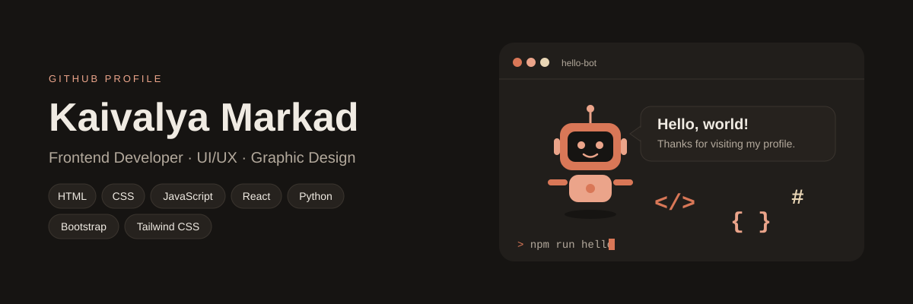

---

## 👋 About Me

🎓 CSE Student at JSPM University, Pune | 💻 Frontend Developer | 🎨 UI/UX & Graphic Designer

Passionate about building visually appealing, user-friendly, and responsive digital experiences. I love turning creative ideas into functional web interfaces through clean code and thoughtful design.

🚀 **What I Do:**
- Frontend Development – Crafting responsive and interactive web experiences.
- UI/UX Design – Designing intuitive, user-centric interfaces.
- Graphic Design – Bringing ideas to life through creative visuals.

💡 **My Strengths:** Creative Thinking • Quick Learning • Adaptability

🌱 Always exploring new technologies, refining my skills, and building projects that combine creativity with technology.

**"Design with creativity. Develop with purpose. Learn without limits."**

## 🛠 Tech Stack

## 🚀 Featured Projects

| Project | Description | Tech |
|---|---|---|
| [Amazon-Frontend-Clone](https://az-frontend-clone.netlify.app/) | A frontend clone of Amazon using html, css and JS | HTML, CSS, JS |
| [Web-Countdown](https://web-countdownkvm.netlify.app/) | JavaSript based countdown on website | Javascript |
| [Portfolio-Site](https://kaivalya-dev-portfolio.netlify.app/) | Personalized Portfolio website | HTML, CSS, Javascript |
## 📫 Connect With Me

&nbsp;

&nbsp;
